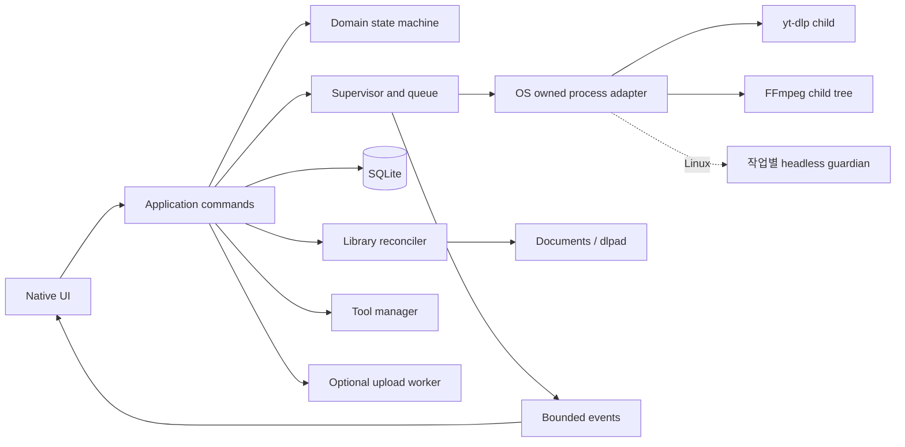

# 아키텍처

## 프로세스 구성

UI와 작업 supervisor는 **하나의 사용자 앱 프로세스**에 있다. Linux에서는 외부 도구 실행마다 같은 앱 바이너리의 짧은 headless guardian을 실행한다. guardian이 yt-dlp/FFmpeg와 자손을 소유하고 앱 연결 단절 시 정리한다. Windows는 native GNU에서 Job Object/process 및 파일 identity·복귀 IPC를 검증했고 격리 GUI의 합성 작업 숨김·복귀도 검증했다. 실제 IME·MSVC 실증은 남았다. macOS adapter의 실제 OS 실증은 아직 남았다. UI 창을 닫아도 백그라운드를 선택하면 supervisor가 살아 있다. 상시 데몬, localhost HTTP 서버, UI와 별도 중복 엔진은 두지 않는다.

현재 개발 workspace: `crates/core`(순수 상태·정책), `crates/engine`(use case·DB·프로세스·파일·네트워크 adapters), `crates/app`(UI·OS integration). 처음부터 모든 adapter를 개별 crate로 쪼개지 않는다. core는 Iced, Tokio, SQLite를 몰라야 한다. ports는 JobRepository, ProcessRunner, ToolResolver, LibraryScanner, SecretStore, MetricsProvider, UploadTransport 정도의 필요한 경계만 둔다.

## 작업 모델

Download 상태: `Queued → Preparing → Downloading → PostProcessing → Verifying → Downloaded`.
실행 중 `Stopping → Paused | Cancelled`, 오류 시 `Failed`, 비정상 종료 후 `Interrupted`.
일시 오류는 제한된 backoff 후 재시도하며 `RetryWaiting`에서 이유와 다음 시각을 표시한다. Paused/Failed/Interrupted의 사용자 재개는 새 Attempt를 만들고 Preparing부터 다시 검증한다. 인증·디스크 부족은 무한 재시도하지 않는다.

업로드는 `Queued → Authorizing → Uploading → Processing → Published`, 보조 상태 `Paused`, `Failed`, `Cancelled`, `NeedsReview`. YouTube 수신 완료와 서버 처리 완료를 구별한다. 다운로드와 업로드를 하나의 성공 bool로 합치지 않는다.

작업 생성 시 URL·범위·품질·저장 위치·옵션·업로드 선택을 snapshot으로 고정한다. 실행 시 선택한 도구의 경로·버전·해시를 Attempt에 기록한다. 이미 실행 중인 작업의 도구를 업데이트하지 않는다. 기본 동시 다운로드 1, 후처리 1, 업로드 1로 시작하며 조정 시 전체 CPU·디스크 경합을 설명한다.

## 외부 프로세스 계약

shell 문자열 대신 executable + argv로 실행한다. stdout/stderr를 동시에 비동기로 배출하고 상한 있는 parser를 둔다. yt-dlp 기계 출력과 FFmpeg progress를 도메인 이벤트로 변환한다. 사람이 읽는 출력 정규식만으로 성공을 결정하지 않는다. 종료 코드, 결과 경로, 파일 확인을 함께 사용한다.

Windows Job Object와 Unix process group 등으로 자손까지 추적한다. 취소는 정상 중단 요청 → 제한 시간 대기 → 프로세스 트리 강제 종료 → 상태 저장 순서다. 플랫폼마다 신호 동작이 다르므로 Ctrl-C 동등 동작을 가정하지 않는다. Linux 앱 크래시는 guardian의 anonymous Unix socket EOF로 감지한다. guardian은 subreaper로 동작하고 도구의 PGID, 아직 reap하지 않은 직접 leader와 입양 자손만 정리한다. 외부 PID를 검색해 종료하지 않는다. readiness 한 바이트를 확인한 뒤 worker를 시작하고 helper 실패 시 기존 process-group-only 방식으로 fallback하지 않는다. 다른 Unix와 guardian 자체의 강제 종료는 추가 실증이 남았다. 재시작 시 PID만으로 프로세스를 죽이지 않고 시작 시각·실행 경로·소유 토큰을 확인한다.

상태 전이/완료/오류 큐는 손실 금지, 진행률은 job별 최신값으로 병합한다. 출력 한 줄 64 KiB, 메타데이터 문서 8 MiB 등 초기 상한을 두고 초과는 진단 가능한 오류로 처리한다. 대형 playlist는 스트리밍 열거하고 사용자 선택량을 제한한다.

## 저장과 복구

| 데이터 | 위치/소유 |
|---|---|
| 최종 미디어 | OS Documents API / dlpad 또는 사용자가 지정한 루트 |
| 미완료 미디어 | 대상 볼륨의 `.dlpad-partials/<job-id>`; 완료 목록 제외 |
| DB·설정·설치 manifest | OS app data/config 디렉터리; Documents와 분리 |
| 관리 도구 | app data/tools/<tool>/<version>/<target> |
| 로그·썸네일 | OS cache/log 디렉터리, 용량·기간 상한 |
| 인증 | OS credential store; DB에는 참조 ID만 |

SQLite 테이블: jobs, attempts, artifacts, library_entries, tool_installations, settings, upload_jobs, schema_migrations. 시간은 UTC, 바이트는 64-bit, 시간 범위는 정수 밀리초. job별 revision과 transaction으로 중복 시작을 막는다. single-instance lock으로 한 데이터 디렉터리의 실행을 직렬화한다. 두 번째 실행은 기존 창을 활성화하며 IPC 도입 시 사용자 전용 named pipe/Unix socket을 쓰고 네트워크 포트는 열지 않는다.

DB와 파일 rename은 하나의 transaction이 아니다. `Verifying` 상태 저장 → 최종 파일 rename → artifact 등록/Downloaded transaction. 크래시 후 Verifying과 실제 파일을 대조하는 idempotent recovery로 간격을 메운다. 같은 볼륨 rename 우선, 충돌 파일은 덮어쓰지 않는다. 설정된 이름 규칙에도 job/source 식별자를 넣는다.

시작 시 실행 중이었던 job은 Interrupted로 복구하고 자동 업로드는 재개 정책 확인 전 시작하지 않는다. VOD는 원본 URL로 재추출한 뒤 `.part` 및 fragment 상태가 호환되면 이어받는다. URL 만료·품질 변경·원본 변경 시 처음부터 다시 받아야 할 수 있음을 안내한다. FFmpeg 후처리는 일반적으로 단계 재시작이며 완전한 이어받기를 약속하지 않는다.

## 라이브러리 조정

watcher + debounce + 시작/사용자 요청 시 증분 스캔. 루트 밖 symlink는 기본 따라가지 않는다. path, size, mtime, 사용 가능한 file ID와 선택적 sidecar로 연결한다. 전체 영상 해시는 기본 계산하지 않는다. DB를 잃으면 파일 목록은 복원되지만 URL·구간·실패 이력은 복원 불가할 수 있다.

폴더 접근 불가·볼륨 분리 상태는 파일 삭제와 다르다. scan 성공 범위에만 missing을 적용한다. 외부 rename은 file ID로 연결 가능할 때만 추정하고 불확실하면 새 파일로 표시한다. `목록에서 숨기기`, `기록 삭제`, `실제 파일 삭제`는 별도 동작이다.

## 확장

진단은 실패 Attempt의 bounded evidence → redactor → Diagnostic report → 로컬 규칙/선택적 외부 분석 경로로 처리한다. core는 evidence와 finding을 구분하며 engine의 report builder와 issue lookup adapter가 I/O를 담당한다. UI와 AI는 보고서 소비자이며 ProcessRunner 권한을 받지 않는다. P0 진단 보고서는 세션 메모리에만 보관하고 자동 disk cache는 0 byte다. 사용자 export와 원본 첨부는 자동 정리하지 않으며 진단은 job 상태를 변경하지 않는다. 세부 한도와 검증은 [진단 계약](DIAGNOSTICS.md)을 따른다.

YouTube upload와 환경 벤치마크는 adapter로 늦게 추가한다. UI를 켜지 않은 로그인 시작 작업·상시 서비스는 초기 범위 밖이며 필요할 때 ADR로 프로세스 모델을 다시 결정한다.

## 개발 구현 상태

[통합 상태](validation/P0-status.md)에 실제 구현 범위를 기록한다. 라이브러리 DB v2, 별도 download_jobs migration v4와 Attempt 도구 증거 테이블을 구현했다. UI는 worker task를 호출하고 pure core 상태·옵션·보고서를 소비한다. native watcher의 bounded dirty hint/debounce는 개발 UI에 연결했다. 진행률 이벤트는 최신 sample로 연결했고 완전한 application command layer는 아직 남았다.

최종 공개 계획을 Verifying 상태와 함께 먼저 저장하고 같은 볼륨 hardlink의 create-only 공개를 사용한다. Unix 복구는 staging/final 파일의 dev+ino·크기·소유 경로를 확인하여 DB 공개 간격을 idempotent하게 닫는다. 사용자 파일을 같은 크기만으로 완료 처리하지 않는다. hardlink 미지원 파일시스템은 실패하며 안전한 rename fallback은 후속이다. Linux 앱 크래시 guardian과 시작 시 journal 복구를 연결했다. Windows 파일 identity/spawn race, macOS crash 처리와 guardian 자체 고장 시험은 출시 차단 사항이다.

## 2026-10-01 개발 연결 결과

고정 yt-dlp JSON progress template의 speed/eta만 bounded line parser로 받아 최신 sample 한 개와 capacity 1 UI channel로 전달한다. malformed/stale 값은 unknown이다. Linux 인터페이스 카운터는 별도 1초 worker로 읽으며 revision으로 이전 선택의 메시지를 거절한다. 기본/선택 저장 루트 생성과 SQLite 설정은 worker에서 처리하고 실패한 선택은 유지하지 않는다. WatchSession은 2초 재연결, root identity/mtime 및 30초 reconciliation hint를 사용한다. 이벤트 누락 때에도 후속 스캔으로 복구하며 실패한 스캔은 관측 목록을 삭제하지 않는다. 추가 runtime dependency나 DB schema 변경은 없다.

선택한 외부 FFmpeg는 옵션 snapshot에 경로를 고정하고 실행 전에 소유 process runner로 -version을 확인한다. download adapter-local migration v3의 download_attempt_components는 Attempt별 canonical 경로와 검증된 버전 token을 보관한다. 기존 library schema와 이전 선택 없는 snapshot은 유지한다. 도구 파일의 외부 변경을 막지는 않으며 버전 확인 시점의 증거다.

## 시작 시 journal 확인

앱 시작은 settings/library 준비와 별도 recovery worker를 실행한다. jobs.sqlite가 없으면 새 DB를 생성하지 않는다. 최종 symlink/폴더와 손상 DB를 거절하고 실패 시 새 다운로드를 차단한다. 성공한 recovery의 변경 수를 안내하지만 다운로드를 자동 재시작하지 않는다. 처리 중/실패/ready는 UI 준비 상태이며 Download job 상태와 독립이다. 동일 ID 재개·이력 UI는 아래 v4 계약으로 연결했다.

## 2026-10-01 이력 재개와 파일 identity

Download adapter v4는 nullable options_json을 추가한다. 새 작업은 버전 1 typed 옵션과 기존 argv snapshot을 함께 저장하고, 128 KiB 이하로 읽어 core 정책을 재검증한다. 둘이 불일치하거나 legacy 옵션이 없으면 재개하지 않는다. 명시적인 재개는 Paused/Failed/Interrupted의 같은 ID에서 새 Attempt를 만든다. UI 이력은 keyset 페이지당 128개이며 원본 URL을 표시하지 않는다. 자동 재시작은 없다.

Library schema v2는 nullable file_identity와 root/identity index를 추가한다. Unix dev/ino가 양쪽 snapshot에서 유일하고 이전 경로가 없으며 새 경로가 비어 있을 때만 기존 row를 이동한다. 전체 scan 실패는 rollback하며 hardlink 중복을 rename으로 추정하지 않는다. inode reuse 때문에 영구 source 증명은 아니며 출처 연결과 비Unix identity는 남는다.

## Linux 기본 소유권 경계의 후속 검증

등록앱의Linux기본은기존사용자systemd의고유transientunit에동일앱headlessguardian을생성한다. argv는ExecStartEx no-env-expand로전달하고KillModecontrol-group으로guardian자체강제소실의detached자손을정리한다. launcher는직접Child로기존stdout/stderr/exitwait를유지하며systemd없는경우약한소유권으로fallback하지않는다. 독립engine개발fixture의directhelper는제품지원능력의증거가아니다. [실제engine와등록앱증거](validation/user-service-final-validation.md), [부분ADR](adr/0002-runtime-and-storage.md)를따른다. 초기서비스식별실패의socketshutdown/고정오류frame은추가실패인수중이며새의존성/schema/상시앱daemon은없다.

## 최신 관측 지표의 mailbox

metrics worker의최신표본과표시key는capacity1 Arc Mutex mailbox에보관한다. 표본timestamp/revision은1초마다교체하고UI는try_lock으로복사한다. 표시key가같으면wake를생략하되3초stale timer와terminalACK wake는유지한다. 종료ACK는stopped release 이후게시하며panic/failure에도wake한다. UI미소비중에첫표본만남는boundedchannel의stale오류를실제Windowsred/green회귀로확인했다. [작업·검증](work-items/S00-metrics-idle-repaint.md).

라이브러리page query는path128KiB/identity128bytes와TEXT타입을검사하고작은validity값을먼저확인한다. 거절payload는NULL로반환해RustString디코딩을막고고정InvalidData오류를게시한다. SQL조건/root/keyset/페이지상한/원DB행은유지한다. SQLite내부거대TEXT index 비교와CAST 비용은별도이다. [작업·검증](work-items/S03-library-db-field-bounds.md).

## Windows 스캔 종료 fixture 경계

기본OFF library-scan-closewait-fixture는 첫 일반파일의 실제 metadata/nativeidentity 및 임시 observations INSERT 뒤, publication 전 callback을 노출한다. 기존 제품 API는 callback 없는 공통 루프를 사용한다. fixture 앱은 exact inherited started/release/workerACK 이벤트3개를 검증하고 inheritance를 제거한다. worker thread에서 최대20초release를 기다리며 release 뒤 즉시cancel을확인한다. transaction반환·자원해제뒤 workerACK를발신하고 stopped.store(Release)를게시한다. UIthread에서긴I/O/join은하지않는다. [실제release/timeout·rollback인수](work-items/S03-windows-scan-closewait-native.md)를따른다. 새schema/dependency/lock변경은없다.

## 미디어 작업 화면 후보

core/media_selection은 길이가 알려진 단일 구간과 독립 playhead의 불변 조건을 소유한다. engine/media_preview는 metadata 및 RGB frame decode를 기존 argv/owned-process/cancel/timeout 경계 안에서 실행한다. app/media_preview_worker는 blocking receiver와 cap1 채널, 실행 하나·최신 pending 하나·세대 비교로 UI thread에서 I/O를 분리한다. app/media_workspace는 texture 한 개, 최대12개 320×180 RGB frame batch와 nominal6fps clock을 유지한다. UI 입력은 다운로드 옵션 snapshot으로 변환하며 미리보기 성공을 다운로드 완료로 취급하지 않는다.

추가 crate/Cargo.lock 변경은 없다. 미리보기 최초 요청 때 worker thread 하나가 생기며 idle은 blocking recv다. per-operation stdout8MiB, decoded batch2,073,600B, title512B와 시간 제한을 적용한다. FFmpeg max_alloc32MiB는 단일 allocation 제한으로 전체 RSS 보증이 아니다. 원격 전체 수신 byte hard cap은 없다. Windows source/tool 원 readonly pin과 최대256 ancestor cap을 보유하고 외부 원본을 삭제하지 않는다. 수명/비용 및 다른 OS의 동등성을 실제 검증 전 완료로 보고하지 않는다.

Windows activation connect idle은 완료/stop event를 함께 기다려20ms polling을 제거한다. stop 우선과 원 Pending의 CancelIoEx/GetOverlappedResult drain을 유지한다. server당 event handle1의 비용을 추가하며 GUI thread에서 이벤트 대기를 실행하지 않는다. [실측/회귀](work-items/S00-windows-restore-idle-event-wait.md).
